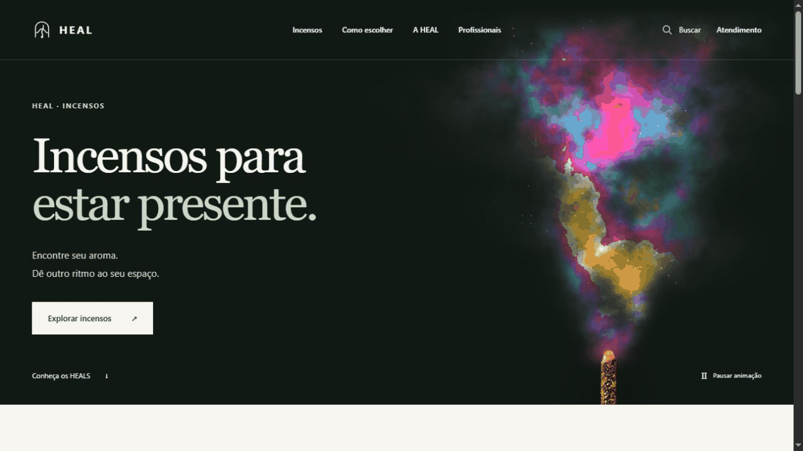

# Interactive Retail Storefront

   [](LICENSE)

A Brazilian Portuguese retail frontend for HEAL incense: editorial product discovery, collection/search views, product details and local shopping-bag flows.

The visual system combines React routes, commerce fixtures, Anime.js interactions and custom GPU-rendered smoke. Three.js studies and fallback components live alongside the main retail experience.

## A storefront built around interaction

The homepage introduces the collection; collection and product routes lead into a bag and a simulated checkout handoff. Catalogue data comes from the [fixture adapter](site/lib/commerce/fixture-adapter.ts), making interface behavior inspectable without a commerce backend.

**Visual demonstration:** the media below is a local capture of the actual smoke component with fixture content. The original incense-stick artwork was supplied to the isolated capture environment; full product media is not bundled in this source snapshot.



## Motion has implementation details

- [HealSmokePlume](site/components/experience/HealSmokePlume.tsx) uses a custom GLSL fragment shader, layered noise and rising color fronts.
- [EmberCartFeedback](site/components/motion/EmberCartFeedback.tsx) and [EditorialSeamReveal](site/components/motion/EditorialSeamReveal.tsx) handle interaction/editorial transitions.
- [MotionControl](site/components/storefront/MotionControl.tsx) exposes a pause control instead of making animation mandatory.
- [Three.js runtime](site/components/three/createEmberSmokeRuntime.js) contains a separate 3D visual implementation.

## Run the frontend

From `site/`, with Node.js 22.13+ and npm:

```console
npm ci --ignore-scripts
npm run dev
```

The project uses Vinext/Vite with Next-compatible routing. Open the local URL printed by the development server. Included product placeholders/fallbacks are part of the interface; omitted binary media must be supplied separately for the complete art direction.

## Commerce behavior and checks

[cart-store.ts](site/lib/commerce/cart-store.ts) owns local bag state; money, fixtures and typed commerce results are kept in [site/lib/commerce](site/lib/commerce). Payment processing, real shipping quotes and production order persistence are outside this prototype.

```console
npm test
npm run build
```

These commands previously passed in the isolated validation environment. Additional Playwright and accessibility scripts are declared in [package.json](site/package.json); they need a running browser/application setup and are distinct from unit tests. The recording demonstrates the visual component, not a completed sale or production checkout.

**Technology:** TypeScript · React · Next-compatible Vinext · Vite · Three.js · Anime.js · Vitest · Playwright

Project-authored source: [MIT](LICENSE). Third-party components retain their own notices and terms.
