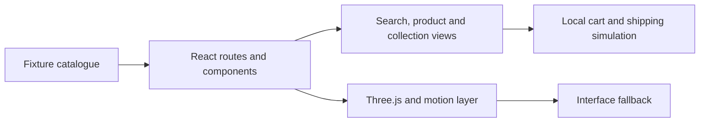

# Interactive Retail Storefront

**A retail interface combining catalogue flows, motion and progressive Three.js scenes.**

   [](LICENSE)

[Overview](#overview) · [Quickstart](#quickstart) · [Example](#example) · [Validation](#validation) · [Documentation](#documentation)

## Overview

A Brazilian Portuguese storefront prototype covering catalogue navigation, product discovery, filtering and a local shopping bag. The frontend connects commerce-oriented interface contracts to motion and progressive 3D presentation, with fallback behavior for the visual layer.

**Stack:** TypeScript · React · Next-compatible Vinext · Vite · Three.js · Anime.js · Vitest · Playwright

## Interface flows

| Component | Behavior |
| --- | --- |
| Discover | Browse collection/product routes and search/filter interactions. |
| Inspect | Connect product content and media to an interactive retail presentation. |
| Build a bag | Maintain local cart state and a simulated shipping flow. |
| Present progressively | Use Three.js and animation with interface fallbacks. |
| Verify separately | Unit, integration, browser and accessibility scripts represent different checks. |

## Processing path



## Quickstart

```console
cd site
npm ci --ignore-scripts
npm run test:unit
npm run build
```

Requires Node.js 22.13+; the recorded validation used Node.js 24.15.0. Run application commands inside site/. npm run dev starts the local Vinext development server. Additional browser gates require Playwright browser installation.

## Example

**Inspect a complete frontend journey**

1. Open a collection and apply a filter or search.
2. Inspect a product and its media/fallback presentation.
3. Add an item to the local bag and change its quantity.
4. Review the simulated shipping/checkout handoff.

The flow is a local prototype. Payment processing, production order persistence and real shipping quotes are not bundled. Screens and binary media depend on the assets present in your checkout.

## Configuration and storage

The application uses React with a Next-compatible Vinext/Vite setup, Three.js and Anime.js. Fixture content and local client state drive the demo. Production backend/CMS contracts are documented as integration work, not delivered services.

## Repository guide

| Location | Responsibility |
| --- | --- |
| [site/app](site/app) | Application routes |
| [site/components](site/components) | UI and visual experiences |
| [site/lib/commerce/cart-store.ts](site/lib/commerce/cart-store.ts) | Local cart state |
| [site/tests/unit](site/tests/unit) | Focused component/unit checks |
| [site/package.json](site/package.json) | Development and QA commands |

## Validation

Node.js 24.15.0 on Windows: all 19 unit tests and the production build passed after a fresh dependency install with lifecycle scripts disabled. Run these commands from `site/`; browser and payment flows were not exercised.

These are the last recorded offline checks (20 October 2026), not a new execution triggered by this documentation revision.

## Scope and operational boundaries

A production build is a compilation result, not a deployed commerce operation. Some binary media are omitted. The recorded checks did not run browser journeys, payment, fulfillment or production deployment.

## Documentation

- [Storefront architecture](docs/architecture/ADR-001-storefront-commerce.md)
- [Commerce contract](docs/commerce/COMMERCE_CONTRACT.md)
- [Motion direction](docs/design/MOTION_BIBLE.md)
- [Performance budget](docs/performance/PERFORMANCE_BUDGET.md)
- [Third-party notices](site/THIRD_PARTY_NOTICES.md)

## License and attribution

Project-authored source code is licensed under the [MIT License](LICENSE). Third-party components and datasets retain their respective rights and licenses.
